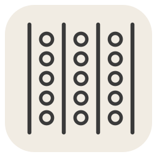
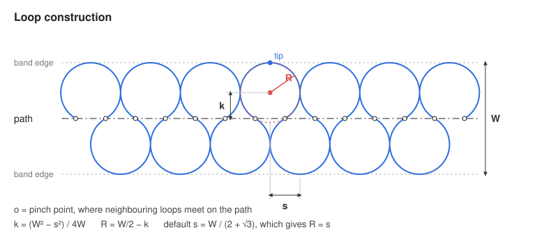
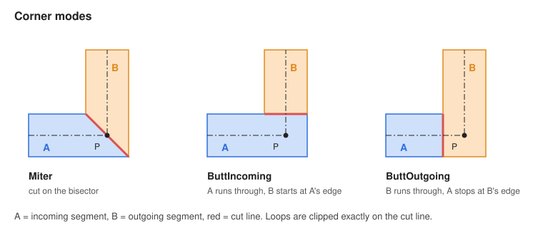

<h1> ArchitecturalAtelierTools</h1>

Rhino 8 tools for drawing architectural detail symbols.

| Icon | Command | What it does |
|------|---------|--------------|
|  | `SoftInsulation` | Draws the soft / batt insulation symbol along a curve. |
|  | `AATPreferences` | Sets the layer each tool draws on. |

## Install

Download the `.yak` from [Releases](../../releases) and drag it into an open Rhino 8 window – or install `ArchitecturalAtelierTools` via `_PackageManager`. Restart Rhino.

## Roadmap

- **SoftInsulation, non-destructive** – edit existing insulation (width, spacing, corners) through a menu instead of redrawing it.
- **Extended preferences** – more settings per tool in `AATPreferences`, not only the layer.
- **Dynamic blocks** – a menu for placing and adjusting parametric detail blocks.
- **Office standards** – template-like setup of layers, line types, hatches etc., so every drawing follows the office standard.

## Repository layout

```
commands/   one .cs file per command (+ optional .json defaults)
icons/      plugin icon + one icon per command (.svg and .png)
docs/       drawings for this README
build.ps1   builds the .yak package and publishes it to the feed
RSoTeSc.rhproj   Rhino project: plugin name, version, icons, commands
```

---

## AATPreferences

Run `AATPreferences` (or click its toolbar button). For each tool, pick a layer from the drawing or type a name, then **Save**. The choice is stored in `%APPDATA%\ArchitecturalAtelierTools\` and used from the next run on. Sublayers work (`Parent::Child`); missing layers are created.

---

## SoftInsulation



1. Run `SoftInsulation`.
2. Pick a curve – or press **Enter** to draw a polyline.
3. Type the band width **W** (tip to tip) and press **Enter**.

The result goes on layer `A_Isolation_01`, joined and grouped. Each run adds a new group; existing insulation is kept.

| Option          | Values                                   | Effect                                                        |
|-----------------|------------------------------------------|---------------------------------------------------------------|
| `Spacing`       | number, `0` = auto                       | Distance **s** between loops. Auto = `W / (2 + √3)`.          |
| `Corner`        | `Miter`, `ButtIncoming`, `ButtOutgoing`  | How two segments meet at a corner.                           |
| `CrossingLoops` | `Trim`, `Remove`                         | Loops hitting a cut line are trimmed exactly or dropped.     |
| `Rhythm`        | `Continuous`, `Restart`                  | Keep loop spacing across corners, or restart at each corner. |
| `DebugDraw`     | `On`, `Off`                              | Draws cut lines on `A_Isolation_01_debug` and logs values.    |

**Principle**

- Loops alternate left / right of the path and meet in **pinch points** on the path.
- Each loop is one arc: pinch point → tip on the band edge → next pinch point.
- Center offset `k = (W² − s²) / 4W`, radius `R = W/2 − k`. Spacing must be smaller than W.
- Each segment is clipped by two cut lines: a perpendicular cap at path ends, a corner cut at each vertex.



Corners sharper than 15° or straighter than 165° always use Miter. Supported paths: lines, polylines (open or closed), polycurves with arcs, single curves – in the XY plane.

**Defaults** come from `SoftInsulation.json` (the layer can also be set with `AATPreferences`). First file found wins:

1. `%APPDATA%\ArchitecturalAtelierTools\SoftInsulation.json`
2. next to the installed plugin
3. next to the script (`commands/`)

```json
{
    "layer_name": "A_Isolation_01",
    "default_width": 0.5,
    "default_spacing": 0,
    "corner_mode": "miter",
    "trim_crossing": true,
    "continuous_rhythm": true
}
```

All keys optional. `corner_mode`: `miter`, `butt_incoming`, `butt_outgoing`.

---

## Development

### One-time project setup

In Rhino: `_ScriptEditor` → **File → Create Project** → save as `ArchitecturalAtelierTools.rhproj` in this folder. In the project settings set the plugin icon to `icons/ArchitecturalAtelierTools.svg`, then add each command (below).

### Add a new command

1. Create `commands/<CommandName>.cs` (copy `SoftInsulation.cs` as a template).
2. Create `icons/<CommandName>.svg` (64×64 viewBox).
3. In the project: **Add → Existing Script** → pick the `.cs` → name the command → set its icon.
4. Add a row to the command table above and release.

### Release

Rhino must be running:

```powershell
.\build.ps1 -Version 1.1.0 -Feed "\\SERVER\share\RhinoPackages"
git tag v1.1.0
```

Builds `build\<version>\*.yak` and copies it to the feed. Every release needs a higher version (`1.0.1` fix, `1.1.0` new command).
