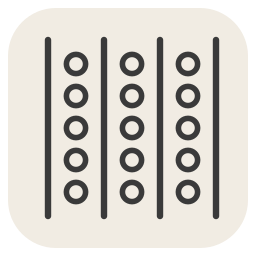
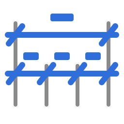
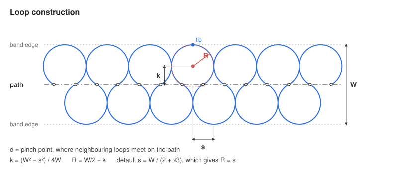
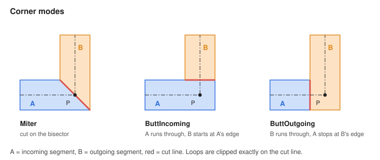

<h1> ArchitecturalAtelierTools</h1>

Rhino 8 tools for drawing architectural detail symbols.

| Icon | Command | What it does |
|------|---------|--------------|
|  | `SoftInsulation` | Draws the soft / batt insulation symbol along a curve. |
|  | `AATDim` | Multi-row dimension chains (like AEC dimensions) with an architectural style: `80` below 1 m, `1.20` from 1 m. |
|  | `AATPreferences` | Sets the layer each tool draws on. |

## Install

Download the `.yak` from [Releases](../../releases) and drag it into an open Rhino 8 window – or install `ArchitecturalAtelierTools` via `_PackageManager`. Restart Rhino.

## Roadmap

- **SoftInsulation, non-destructive** – edit existing insulation (width, spacing, corners) through a menu instead of redrawing it.
- **Extended preferences** – more settings per tool in `AATPreferences`, not only the layer.
- **Dynamic blocks** – a menu for placing and adjusting parametric detail blocks.
- **Office standards** – template-like setup of layers, line types, hatches etc., so every drawing follows the office standard.

## Repository layout

```
commands/   one .cs file per command (+ optional .json defaults)
icons/      plugin icon + one icon per command (.svg and .png)
docs/       drawings for this README
build.ps1   builds the .yak package and publishes it to the feed
RSoTeSc.rhproj   Rhino project: plugin name, version, icons, commands
```

---

## AATPreferences

Run `AATPreferences` (or click its toolbar button). For each tool, pick a layer from the drawing or type a name, then **Save**. The choice is stored in `%APPDATA%\ArchitecturalAtelierTools\` and used from the next run on. Sublayers work (`Parent::Child`); missing layers are created.

---

## SoftInsulation



1. Run `SoftInsulation`.
2. Pick a curve – or press **Enter** to draw a polyline.
3. Type the band width **W** (tip to tip) and press **Enter**.

The result goes on layer `A_Isolation_01`, joined and grouped. Each run adds a new group; existing insulation is kept.

| Option          | Values                                   | Effect                                                        |
|-----------------|------------------------------------------|---------------------------------------------------------------|
| `Spacing`       | number, `0` = auto                       | Distance **s** between loops. Auto = `W / (2 + √3)`.          |
| `Corner`        | `Miter`, `ButtIncoming`, `ButtOutgoing`  | How two segments meet at a corner.                           |
| `CrossingLoops` | `Trim`, `Remove`                         | Loops hitting a cut line are trimmed exactly or dropped.     |
| `Rhythm`        | `Continuous`, `Restart`                  | Keep loop spacing across corners, or restart at each corner. |
| `DebugDraw`     | `On`, `Off`                              | Draws cut lines on `A_Isolation_01_debug` and logs values.    |

**Principle**

- Loops alternate left / right of the path and meet in **pinch points** on the path.
- Each loop is one arc: pinch point → tip on the band edge → next pinch point.
- Center offset `k = (W² − s²) / 4W`, radius `R = W/2 − k`. Spacing must be smaller than W.
- Each segment is clipped by two cut lines: a perpendicular cap at path ends, a corner cut at each vertex.



Corners sharper than 15° or straighter than 165° always use Miter. Supported paths: lines, polylines (open or closed), polycurves with arcs, single curves – in the XY plane.

**Defaults** come from `SoftInsulation.json` (the layer can also be set with `AATPreferences`). First file found wins:

1. `%APPDATA%\ArchitecturalAtelierTools\SoftInsulation.json`
2. next to the installed plugin
3. next to the script (`commands/`)

```json
{
    "layer_name": "A_Isolation_01",
    "default_width": 0.5,
    "default_spacing": 0,
    "corner_mode": "miter",
    "trim_crossing": true,
    "continuous_rhythm": true
}
```

All keys optional. `corner_mode`: `miter`, `butt_incoming`, `butt_outgoing`.

---

## AATDim

Dimension chains with several rows in one object – similar to AEC dimensions in AutoCAD.

1. Run `AATDim`, set `Rows` (how many dimension lines).
2. Pick all points, **Enter**.
3. Click where the first dimension line goes. The other rows follow outwards, one row spacing apart.

Every row gets all points, the last row is the overall dimension (first to last point). Then thin out the rows with the buttons (below). The chain goes on layer `A_Bemassung_01` and is grouped. Each row is a continuous chain.

**Buttons on a selected chain**

Select a chain – small buttons appear next to it:

- **`<>`** on every measure point – click it, then click the new location (osnaps work, live preview, typed coordinates too). The point moves in every row; on top of a neighbour the two dimensions merge.
- **`x`** on every point between two dimensions – click to remove the point from that row, the two dimensions become one.
- **`-`** at the start of each row – deletes the row.
- **`+`** below the outermost row – adds a row with all points.
- **`+`** (orange) right next to every dimension text – type a text that goes below this dimension line, e.g. `RPH 2.10` under a door width. Once set, the button shows **`T`**; click it to edit, leave it empty to remove.
- **`...`** next to the first row – opens the chain menu:
  - *Distance between dimension lines* in mm on paper. The first row stays, the others are re-spaced; new rows use it too.
  - *Text below the dimension line* for every dimension, e.g. `RPH 2.10` under a door width. The text is a normal text object in the chain's group, centred under its dimension, and follows it when points move. Clear the field to remove it.

The chain stays selected, so you can click the next button right away. Buttons are hidden while a command runs.

| Option       | Values                                    | Effect                                                                   |
|--------------|-------------------------------------------|--------------------------------------------------------------------------|
| `Rows`       | 1 – 9                                     | Number of dimension rows (default from `default_rows`).                  |
| `Direction`  | `Auto`, `Horizontal`, `Vertical`, `Aligned` | Measuring direction. Auto = the longer side of the points (CPlane X or Y). Aligned = first → last point. |
| `Edit`       | pick a chain                              | `AddPoints`, `RemovePoints`, `AddRow`, `AddOverall`, `DeleteRow`; `Row` picks the row to edit. |
| `Update`     |                                           | Re-checks the format of every dimension with the style.                 |
| `ResetStyle` |                                           | Rebuilds the style from `AATDim.json` and makes it current.             |

**The style `AAT_Bemassung`**

- Text 2 mm (paper), Arial, ticks, text above the line. Model space scale 50 (= 1:50).
- Below 1 m in centimetres without decimals (`80`), from 1 m in metres with two decimals (`1.20`). Rhino can't switch units by value natively, so each dimension gets a small unit override. Everything else follows the style.
- The style is made current, so normal `_Dim` dimensions get the same format too.

**Editing like one object**

After `AATDim` has run once in a session, it watches dimension edits (and shows the buttons):

- Drag a measure point (grips, `Stretch`, `Move` of one dimension) – every row that shares the point follows. Dragging a point onto its neighbour merges the two dimensions.
- Drag a dimension line – the whole row moves with it.
- A dimension that crosses 1 m switches between `80` and `1.20`.
- **Undo** reverts the follow-up changes first, the edit itself with the second undo.
- `Copy` gives an independent chain. `Ungroup` detaches the dimensions from the chain.
- Use the `x` button (or `Edit → RemovePoints`) instead of deleting single dimensions – a deleted dimension inside a row is filled in again at the next edit.

To have the watcher on from the start, add `AATDim _Update` to *Options → General → Command lists → Run these commands every time Rhino starts*.

**Defaults** come from `AATDim.json` (same lookup order as SoftInsulation; the layer can also be set with `AATPreferences`):

```json
{
    "layer_name": "A_Bemassung_01",
    "style_name": "AAT_Bemassung",
    "text_height_mm": 2.0,
    "model_space_scale": 50,
    "meter_threshold": 1.0,
    "cm_decimals": 0,
    "m_decimals": 2,
    "decimal_separator": "."
}
```

Also available: `default_rows` (2), `last_row_overall` (true), `font`, `row_spacing_mm` (7), `tick_size_mm` (2), `text_gap_mm` (1), `extension_offset_mm` (1), `extension_overshoot_mm` (1.5), `dimline_overshoot_mm` (1.5). Style changes apply to new drawings, or after `ResetStyle`.

---

## Development

### One-time project setup

In Rhino: `_ScriptEditor` → **File → Create Project** → save as `ArchitecturalAtelierTools.rhproj` in this folder. In the project settings set the plugin icon to `icons/ArchitecturalAtelierTools.svg`, then add each command (below).

### Add a new command

1. Create `commands/<CommandName>.cs` (copy `SoftInsulation.cs` as a template).
2. Create `icons/<CommandName>.svg` (64×64 viewBox).
3. In the project: **Add → Existing Script** → pick the `.cs` → name the command → set its icon.
4. Add a row to the command table above and release.

### Release

Rhino must be running:

```powershell
.\build.ps1 -Version 1.1.0 -Feed "\\SERVER\share\RhinoPackages"
git tag v1.1.0
```

Builds `build\<version>\*.yak` and copies it to the feed. Every release needs a higher version (`1.0.1` fix, `1.1.0` new command).

Open for forking, maybe more people in architecture can contribute to some "necessary" commands for Rhino :)
